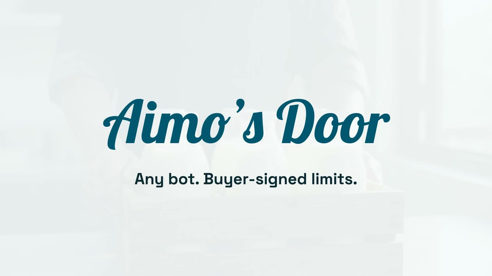
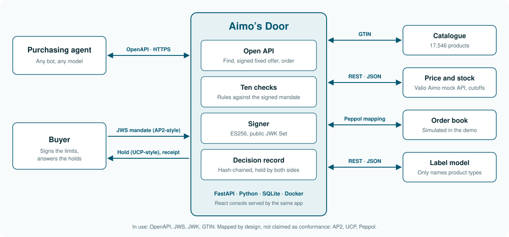
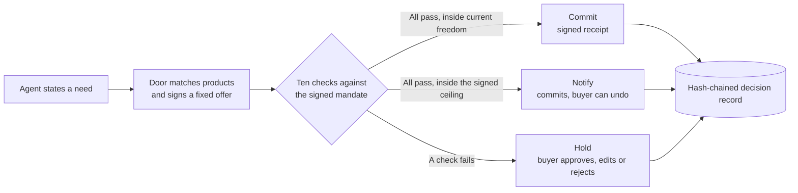
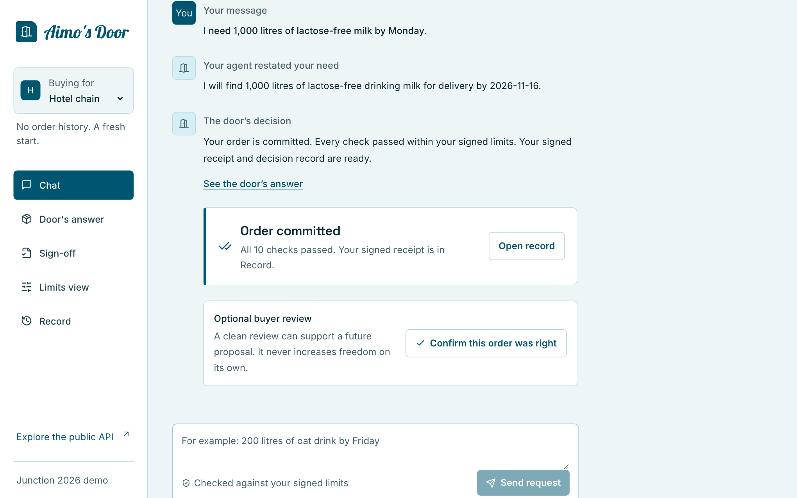
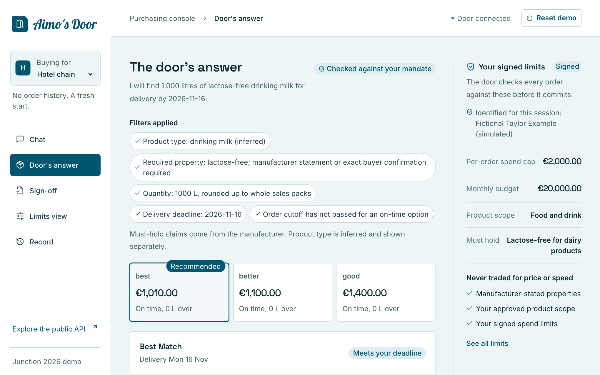
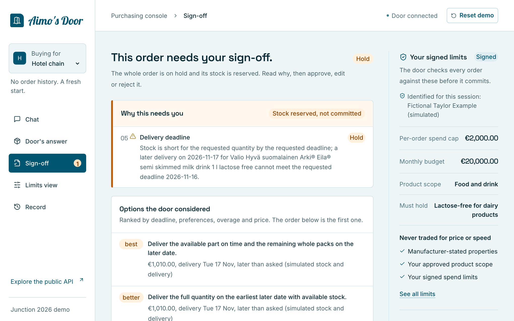
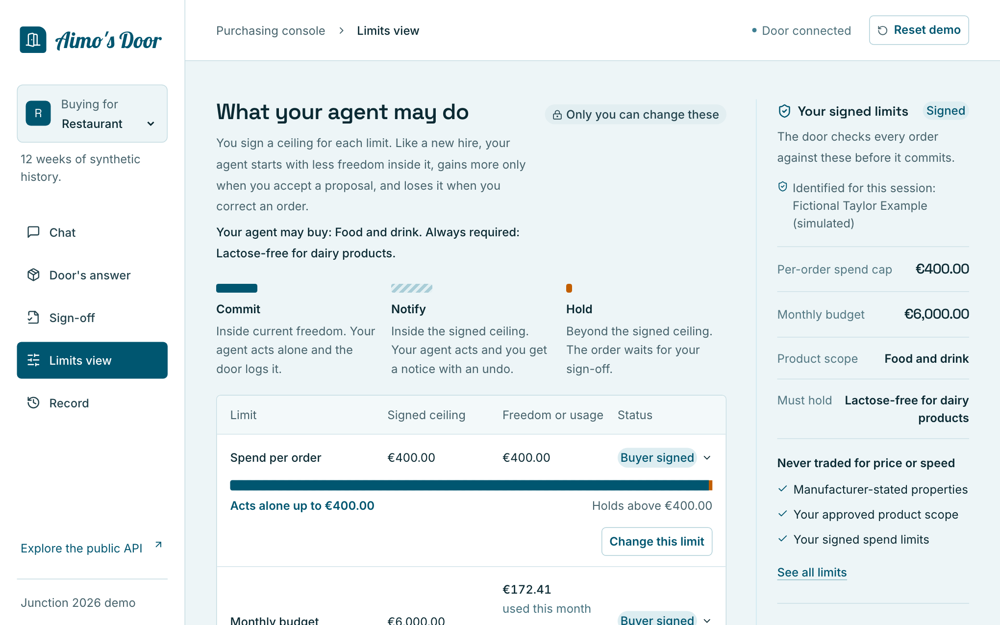
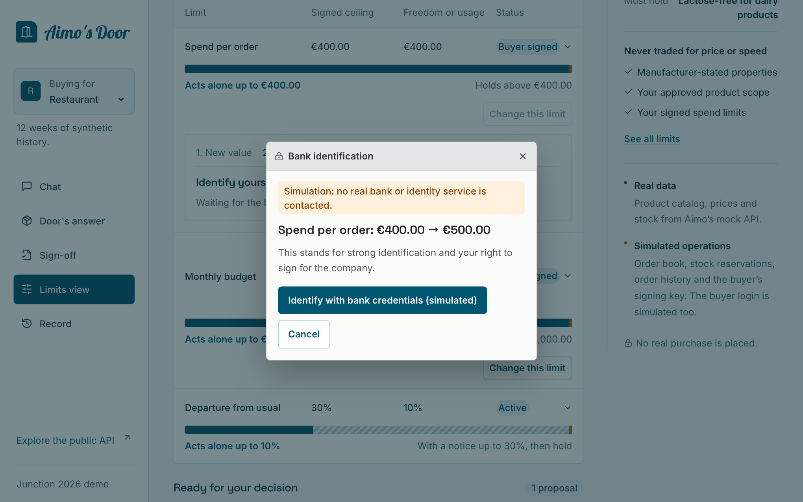
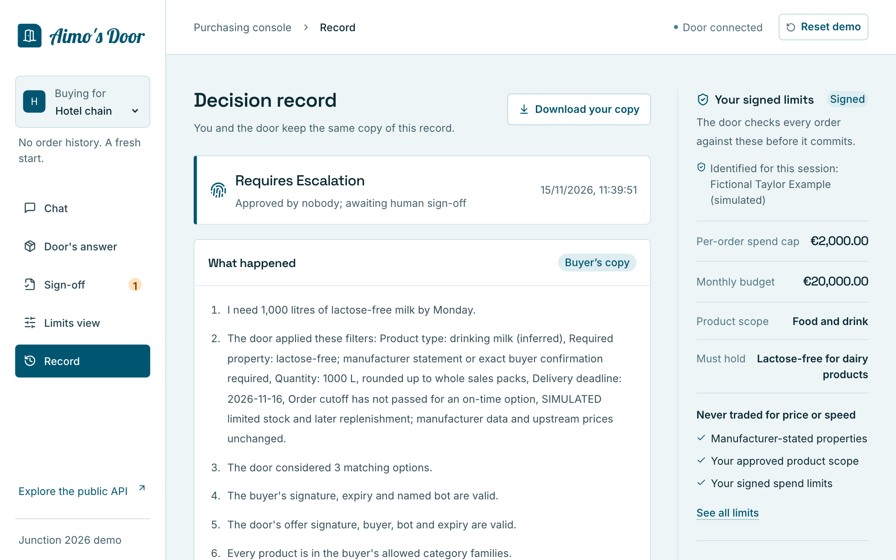

# Aimo's Door

**An open door for purchasing agents: any bot can buy from a wholesaler, inside limits its buyer has signed.**

Built for Valio Aimo's *Trusted Trade Agents* challenge at Junction 2026.

[](docs/media/aimos-door-demo.mp4)

▶ **[Demo video, 1 min 50 s](docs/media/aimos-door-demo.mp4)**

## The idea

A purchasing agent makes judgement calls with real money. So it starts like a new hire: with a mandate, and trust it has to earn.

1. **The buyer signs the limits.** A per-order cap, a monthly budget, a product scope, properties that must hold, and how far an order may depart from the usual one.
2. **The door enforces them and can never widen one.** Raising a limit takes the buyer, a strong identification and a new signed mandate.
3. **Every decision leaves a record both sides hold.** Offers, mandates and receipts are signed; decision records are chained by hash.

Autonomy is earned. After clean approvals the door proposes more freedom, and only the buyer can accept it. One undo takes it back at once.

## How it works





The ten checks are plain rules: buyer authority, signed offer, product scope, must-hold properties, delivery deadline, per-order cap, monthly budget, substitution preferences, departure from the usual order, and new request. A language model only turns sentences into structured requests and labels product types; it never decides an order.

## The console

| | |
| --- | --- |
|  **Chat.** A complete instruction commits by itself. |  **Door's answer.** What was matched, and why. |
|  **Sign-off.** Short stock: the order waits for a human. |  **Limits view.** Signed ceilings and earned freedom. |
|  **Changing a limit.** Only the buyer, after identification (simulated). |  **Record.** The same copy for buyer and door. |

## Try it

There is no hosted demo: the catalogue is licensed to the event, and the chat runs on a paid model. The app runs offline on built-in fixtures instead, with no keys:

```sh
make demo
```

Open http://127.0.0.1:8766 and type `I need 1,000 litres of lactose-free milk by Monday.` Tick *Simulate limited stock* and send it again to see a hold.

Then let a forty-line agent place an order over plain HTTP and verify the signed receipt:

```sh
uv run python examples/minimal_agent.py --door http://127.0.0.1:8766
```

**MCP.** The same operations are also MCP tools, so Claude, Cursor or any other MCP client can buy through the door. The agent can search, match, get an offer, order and read the result; approving a hold, undoing and changing limits stay with the buyer and have no tool.

```sh
uv run python examples/mcp_server.py --door http://127.0.0.1:8766 --customer hotel
```

Needs Python 3.12+, [uv](https://docs.astral.sh/uv/), Node.js 22.12+ and make. Running against the real catalogue and a real model needs event keys; see [docs/SETUP.md](docs/SETUP.md).

## What is real, what is simulated

- **Real:** the catalogue with GTINs and manufacturer claims, prices and stock from Valio Aimo's mock API, ES256 signatures with a public key set, the hash-chained record, the model calls.
- **Simulated, and labelled so in the console:** the order book and reservations, the restaurant's order history, buyer logins, signing keys and the bank identification. No purchase is sent to Valio.

## Verification

Readiness is defined by 115 executable cases in [ACCEPTANCE.md](ACCEPTANCE.md), written before the code, one test per case. All 115 pass, with 104 unit tests. [STATUS.md](STATUS.md) lists what was verified and the known limits.

```sh
make test
```

## Stack and standards

- **Stack:** Python 3.12, FastAPI, SQLite; React, TypeScript, Vite; Docker Compose.
- **In use:** OpenAPI, JWS and JWK (ES256), GTIN.
- **Mapped by design, not claimed as conformance:** AP2 mandates, UCP escalation, Peppol order response. Details in [docs/standards.md](docs/standards.md).

## More

- [docs/API.md](docs/API.md): the public contract.
- [docs/SETUP.md](docs/SETUP.md): running with real data, configuration, deployment.
- [docs/assumptions.md](docs/assumptions.md): what production would need.
- [docs/design-plan.md](docs/design-plan.md): the console's design.

## How it was built

The product and design decisions are mine. The code was written with AI coding agents, against acceptance cases agreed first and re-run independently before each merge.

## Licence

Code: [MIT](LICENSE). The Valio Aimo Junction 2026 data is licensed for the event only and is not in this repository. This is an independent hackathon project, not affiliated with or endorsed by Valio or Valio Aimo.
