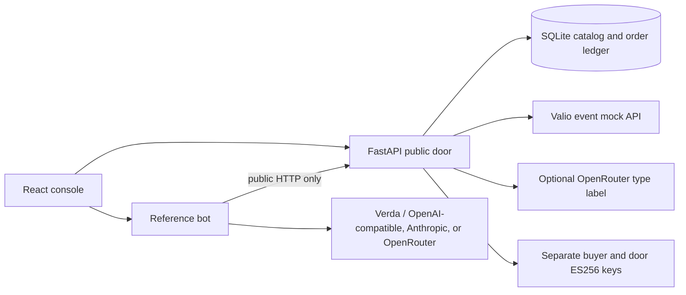

# Setup, configuration and deployment

How to run Aimo's Door with the real catalogue, configure it and deploy it. The overview is in the [README](../README.md).

## Run locally

Prerequisites: Python 3.12+, [uv](https://docs.astral.sh/uv/), Node.js 24+ (or 22.12+), npm, and make. Keep the supplied `.env` private. On a new checkout, copy `.env.example` to `.env` and enter keys in an editor; do not overwrite an existing `.env`.

One command installs dependencies, builds the console, and starts the app:

```sh
make run
```

Open [http://127.0.0.1:8000](http://127.0.0.1:8000). Health is at `/healthz`, interactive documentation at `/docs`, and OpenAPI at `/openapi.json`. First start streams the event files in the parent directory into SQLite, or downloads them with the Valio key if absent. Later starts reuse `DATA_DIR`.

For UI development, run `npm --prefix frontend run dev` alongside the API; Vite proxies API requests to port 8000. `make build` rebuilds the production console.

## Bring your own agent

The door is plain HTTP and JSON, described by OpenAPI at `/openapi.json`. An agent needs no SDK and no particular model. [examples/minimal_agent.py](../examples/minimal_agent.py) is a complete agent in about forty lines: it states a need, gets a signed fixed-price offer, places the order, prints the ten checks, and verifies the door's signature on the receipt against the public keys.

```sh
uv run python examples/minimal_agent.py --door http://127.0.0.1:8000
```

The reference bot behind the Chat view uses the same public operations and nothing else.

## Demo

The five views are Chat, Door's answer, Sign-off, Limits view, and Record. A customer switcher and Reset demo are always available.

The chat is a conversation. You can ask what Aimo sells ("What lactose-free milk do you have?", "Which is the cheapest?"), ask about your limits or your usual order, and give an order. The agent places an order by itself only when the instruction is complete (product, quantity, delivery date); without a date it shows a draft to confirm, and without a quantity it asks. In the Limits view the buyer can change a signed limit after a simulated bank identification; the door itself can never raise one.

| Act | Customer | Request |
| --- | --- | --- |
| 1 | Hotel chain | `I need 1,000 litres of lactose-free milk by Monday.` |
| 2 | Hotel chain | The same request with limited stock; review alternatives and approve on Sign-off. |
| 3 | Restaurant | After reset, inspect the pending limits proposal, then type `Same as last week, plus 5 litres more milk.` Review the notice and use undo. |

Reset removes demo orders, reservations, and decisions and restores seeded demo state; it retains the catalog, inference cache, and signing keys.

For Act 3's Notify demonstration, leave the proposal pending until after inspecting the order. The milk increase is 20% of the confirmed baseline: above initial 10% freedom and below the 30% signed ceiling. Accepting the initial proposal first raises freedom to 20%, so the same reorder can commit silently. Undo tightens freedom to zero and removes obsolete proposals; Reset demo restores the starting scenario. Use “Confirm this order was right” to record an explicit clean review; four reviews can support a new proposal but never loosen freedom automatically.

## What is real and simulated

| Real implementation or input | Simulated demo component |
| --- | --- |
| Event catalog, GTINs, manufacturer claims, origin, labels | Buyer identities and locally held buyer signing keys |
| Prices and availability fetched from Valio's **mock** API | Order book, reservations, commitment, cancellation, sign-off |
| ES256 signatures, JWK verification, SQLite transactions, hash-linked records | Restaurant history and its human-confirmed anchor |
| Configured model calls and cached product-type inference | Buyer login sessions; simulated bank identification and company signing authority; the explicitly labelled limited-stock toggle |

No commercial purchase is sent to Valio: its event API has no order or reservation operation. Product type is **inferred**; a model label is never manufacturer evidence for an allergen or nutritional claim. Prices and limits are EUR excluding VAT, with that basis stated in offers.

## Buyer session — simulated login

`POST /demo/buyer-session` with `{ "customer_id": "hotel" }` returns a token, customer ID, expiry, public session ID, and an explicit simulated-login label. This is a demonstration credential, not production authentication. Keep it in the buyer's console; the reference bot never issues or stores it.

Human actions require `X-Buyer-Session: <token>` for the same customer: sign-off approval, rejection, edit, acknowledgement and exact product-property confirmation; undo; proposal acceptance; freedom reset or learned-preference removal; new mandate registration; signed-limit change; and `POST /demo/reset`. A missing/invalid credential returns 401 and the wrong customer's credential returns 403. Preparing an answer does not commit or learn anything; final `/bot/chat` confirmation requires the human header and forwards it only for that one step. The decision record names the public session ID, never the bearer token.

Changing the per-order cap or monthly budget additionally requires `POST /demo/identify` with the buyer session and `{ "customer_id": "hotel", "method": "bank" }`. It returns a five-minute, single-use proof for a clearly fictional signer and simulated company authorisation; no real identity provider is contacted or imitated. Send that opaque proof as `X-Identification-Proof` to `POST /limits/{limit_id}/change`. A successful change creates a superseding buyer-signed mandate and a linked decision record. Missing, expired, replayed or mismatched proofs change nothing.

`GET /usual-order`, `GET /limits`, and `GET /orders/{order_id}` accept either that buyer header or bot read authority: `Authorization: Bearer <mandate>` plus `X-Bot-Id: <bot-id>`. `GET /mandates/{mandate_id}` returns only `{ "payload": ... }`, never the signed mandate token.

## Architecture



FastAPI serves the Vite-built React/TypeScript/Tailwind console. The portable `reference_bot` package imports no door policy or database code. It converts a sentence into a bounded tool call, restates the need, then uses public match, offer, and order endpoints. The door applies deterministic checks and signs documents with PyJWT/cryptography. Catalog indexing streams the original dataset.

## Configuration

The app loads `.env` with dotenv; existing process variables take precedence. Never put keys in client variables, source, logs, or commits.

| Variable | Purpose and default |
| --- | --- |
| `VALIO_API_KEY` | Required for downloads, prices, and stock; sent only to Valio. |
| `AGENT_PROVIDER` | `openai_compatible`, `openrouter`, or `anthropic`. Unset defaults to `openai_compatible`, the selected production/test configuration. |
| `AGENT_BASE_URL` | Chat-completions base for `openai_compatible`; Verda default `https://inference.verda.com/v1`. An OpenRouter-compatible base can also be configured. |
| `AGENT_API_KEY` | Bearer key for the configured `AGENT_BASE_URL`; required for `openai_compatible`. |
| `OPENROUTER_API_KEY` | Required for the dedicated OpenRouter provider; also enables decision labels; sent only to OpenRouter. |
| `ANTHROPIC_API_KEY` | Required only when using Anthropic. |
| `ANTHROPIC_BASE_URL` | Optional Anthropic-compatible base; default `https://api.anthropic.com`. |
| `AGENT_MODEL` | Exact primary provider model ID. Verda default `deepseek-4-1-flash-1017`. Anthropic default `claude-opus-5-5`; dedicated OpenRouter discovers the exact Opus 5.5 slug when no override is set. |
| `AGENT_FALLBACK_MODEL` | Model used once after both primary attempts fail or time out; default `kimi-k3-1-pro` for `openai_compatible`, otherwise unset. Set empty to disable fallback. |
| `DECISION_MODEL` | Default `typesafe/jev-1.14`; type classification only. Ordinary failures or a missing key use rules. |
| `DATA_DIR` | Persistent index, ledger, caches, usage counts, and keys. Local `data`; container `/app/data`. |
| `PUBLIC_BASE_URL` | External origin for absolute sign-off links; example `https://door.example.com`. |
| `DOOR_API_BASE_URL` | Internal HTTP origin for the bot; container `http://127.0.0.1:8000`. |
| `DOOR_PORT` | Compose host port; default `8650`. Container port is 8000. |
| `DEMO_ACCESS_CODE` | Demo gate. Set it for any instance reachable from the internet, and give the code to the people who should try the demo; empty disables the gate. |
| `DEMO_IDLE_RESET_MINUTES` | Reset the shared demo before the first door request after this many idle minutes; default `20`. The response carries `X-Demo-Idle-Reset: 1`, and `/demo/customers` exposes `idle_reset_at`. Health checks, static assets, and model warm-ups neither count as activity nor trigger a reset. Set `0` to disable, including for a presenter running the demo on their own laptop. |
| `MODEL_DAILY_CAP` | Visitor inference calls admitted per UTC day across bot and labels; default `300`. Warm-ups are excluded. |
| `BOT_CHAT_RATE_LIMIT` | Separate `/bot/chat` admission count per address; default `20`. |
| `BOT_CHAT_RATE_WINDOW_SECONDS` | Bot-chat limiter window; default `60`. |
| `DEMO_RATE_LIMIT` | General per-address request count; default `120`. Internal bot-to-door calls use a separate authenticated exemption. |
| `DEMO_ACCESS_MAX_FAILURES` / `DEMO_ACCESS_LOCKOUT_SECONDS` | Wrong access codes allowed per address (default `10`) before that address is refused for the lockout period (default `600` seconds). Applies to the unlock form and the `X-Demo-Access-Code` header. |
| `CLIENT_IP_HEADER` | Optional. Header that carries the visitor's address when an edge sits in front of your proxy, for example `Cf-Connecting-Ip` behind a Cloudflare Tunnel. Honoured only from a private or loopback peer. Without it, all visitors behind such an edge can share one address and one limit. |
| `DEMO_RATE_WINDOW_SECONDS` | General limiter window; default `60`. |
| `BUYER_SESSION_TTL_SECONDS` | Simulated buyer-session lifetime, minimum 300; default `28800` (8 hours). |
| `AGENT_WARMUP_ENABLED` | `1` enables bounded startup/idle warm-up; set `0` to disable. |
| `DOOR_SIGNING_KEY` | Optional ES256 P-256 private PEM; otherwise generated and persisted in `DATA_DIR/keys`. |

The selected production and test bot uses Verda DeepSeek Flash: `AGENT_PROVIDER=openai_compatible`, `AGENT_BASE_URL=https://inference.verda.com/v1`, `AGENT_MODEL=deepseek-4-1-flash-1017`, and a private `AGENT_API_KEY`. The server makes one cheap warm-up request at startup and no more than one every five minutes while idle, then stops warming after 30 idle minutes and resumes on real bot activity. Warm-ups do not count against `MODEL_DAILY_CAP`. A failed or timed-out visitor inference gets exactly one primary retry, then one request to `AGENT_FALLBACK_MODEL` (Kimi by default on Verda); there are no retry loops. Those visitor retries and the fallback do count toward the cap. Model metadata identifies the model that answered. Each bot inference request is capped at `max_tokens=800`.

The app also runs with **only an OpenRouter key and a Valio key**: set `AGENT_PROVIDER=openrouter` and remove the Verda `AGENT_MODEL` override, or replace it with an exact OpenRouter model slug. No Anthropic or Verda key is needed for that route. The `anthropic` provider remains available with its own key/base and an appropriate model override. Always change the model ID together with the provider. Offline tests use stubs; LIVE tests may incur model charges.

The bot prompt includes a table of the next 14 days in English and Finnish. Code rejects past deadlines and asks for clarification before calling the door. A model response with neither a tool call nor text also produces a fixed clarifying question; it does not silently place an order.

## Deploy with Docker Compose

Use Docker Compose behind a TLS-terminating reverse proxy. These instructions do not publish or deploy anything.

Copy the private `.env` to the repository directory on the server. Set `PUBLIC_BASE_URL=https://door.example.com` and the chosen provider's keys. Set `DEMO_ACCESS_CODE` for a public instance. Then run:

```sh
docker compose up -d --build
```

Compose publishes `127.0.0.1:${DOOR_PORT:-8650}:8000`, uses `restart: unless-stopped`, checks `/healthz`, and stores the index, ledger, and signing keys in the named `door-data` volume. First start downloads licensed data and builds the index; wait until the service is healthy.

Point your tunnel or reverse proxy at `http://localhost:8650` (or `DOOR_PORT`). The host port is bound to loopback so visitors arrive through the proxy. The container trusts forwarded protocol/address headers from loopback and private proxy networks. Direct public peers cannot choose their rate-limit identity using a forwarded header. The bot uses container loopback; user-facing links use `PUBLIC_BASE_URL`.

### Behind a Caddy reverse proxy

Create one external Docker network, attach your Caddy container to it, and set `PROXY_NETWORK` to that name in the private `.env`. Then use the Caddy overlay instead of publishing an origin host port:

```sh
export PROXY_NETWORK=aimos-door-proxy
docker network create "$PROXY_NETWORK"
docker network connect "$PROXY_NETWORK" <existing-caddy-container>
docker compose -f docker-compose.yml -f docker-compose.caddy.yml up -d --build
```

The overlay removes the base file's `ports` mapping. Caddy reaches `door:8000` over the shared proxy network; the private default network remains attached for the application. Set `PUBLIC_BASE_URL=https://door.example.com` as usual. The matching Caddy site block is:

```caddyfile
https:// {
    @door host door.{$DOMAIN}
    handle @door {
        reverse_proxy door:8000
    }
}
```

Update:

```sh
git pull && docker compose up -d --build
```

Read logs and health:

```sh
docker compose logs --tail=100 -f door
docker compose ps
```

Avoid `docker compose down -v` when retaining records and signing identity: `-v` deletes the persistent volume. The multi-stage image contains production Python dependencies and built assets, without Node.js, `node_modules`, licensed data, or private keys. An optional [Render blueprint](../render.yaml) is supplied.

## Tests and receipt verification

With the app running at port 8000:

```sh
make test
make acceptance
```

`make test` runs offline Python unit tests and front-end DOM tests. Acceptance executes one test per case ID and prints the complete PASS/FAIL table. LIVE cases exercise the local server and real external services. Reports are under ignored `data/verification/`.

Save a receipt JWS, or an order JSON response containing `receipt`, to `receipt.json`, then verify without a private key:

```sh
uv run python scripts/verify_receipt.py receipt.json --jwks http://127.0.0.1:8000/.well-known/jwks.json
```

Tampered receipts cause a nonzero exit. See [API.md](API.md) for the public contract and [assumptions.md](assumptions.md) for production integration needs.

## Standards

| Standard | Status |
| --- | --- |
| OpenAPI | Implemented HTTP description and interactive docs. |
| JWS / JWK | Implemented ES256 documents and public key set. |
| GTIN | Implemented identifier pass-through where supplied. |
| UCP | Mapped escalation names: `requires_escalation`, `continue_url`. |
| AP2 | Mapped open/closed mandate concepts; no wire-format claim. |
| Peppol | Mapped order response/cancellation; no network exchange. |

The precise scope and primary references are in [standards.md](standards.md).

## Licence

Application code uses the [MIT licence](../LICENSE). Valio Junction 2026 product, reliability, and carbon data are separately event-licensed and **not** covered by MIT. Do not commit, redistribute, or bake those files into the image.
